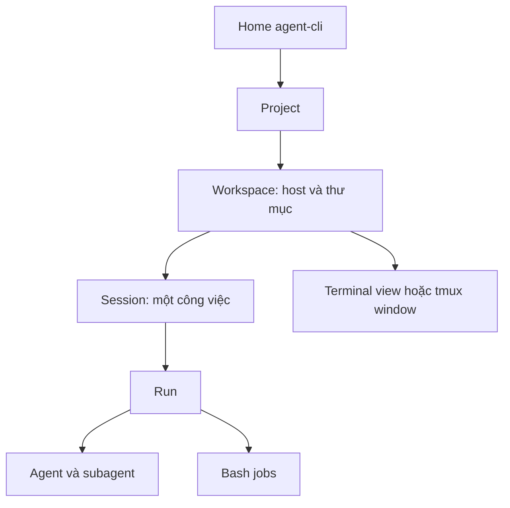

# Roadmap agent-cli cá nhân — Core MVP cho dev/devops

Ngày lập: 14/10/2026. Đây là roadmap/spec để triển khai theo lô nhỏ, không phải báo cáo tính năng đã hoàn thành.

> Người thi hành: Opus effort high theo luật box, được quyền phản biện plan bằng bằng chứng từ code/runtime. Agent đọc quy tắc repo trước khi thực hiện. Không viết số kết quả chưa đo; không nở phạm vi; không tự ý commit/push.
> Không nạp toàn bộ lịch sử chat vào prompt. Đọc tài liệu này, sau đó chỉ đọc phần/file cần cho lô đang làm. Roadmap không thay thế brief và review cho từng lô.

## 1. Mục tiêu và ranh giới

Một môi trường terminal cá nhân để làm FE, BE và devops: mở dự án, tiếp tục công việc, đọc/sửa code, chạy test/build, giao review, quan sát tiến trình và xử lý lỗi. Tái sử dụng lõi Crush; không viết lại framework agent hay TUI.

Phase 1 phải giúp người dùng làm việc ngay và tin được trạng thái. Không cần GUI, RAG, workflow kéo thả, multi-tenant, billing, marketplace hoặc remote orchestration để đạt MVP.

Giấy phép và thông báo upstream phải được giữ. Không coi fork là mã viết mới hoàn toàn. Kiểm tra điều khoản hiện có trước mọi hướng phân phối thương mại; roadmap này dành cho sử dụng cá nhân.

## 2. Mô hình dữ liệu và tư duy sản phẩm

| Đơn vị | Ý nghĩa | Quy tắc |
|---|---|---|
| Project | Dự án/repo logic | Có thể có nhiều worktree/workspace |
| Workspace | Thư mục làm việc gốc trên một host | Cwd, branch, config, dữ liệu và runtime rõ ràng |
| Session | Một công việc trong workspace | Hội thoại, draft, trạng thái và lịch sử riêng |
| Run | Một lượt thực thi | Có bắt đầu/kết thúc/kết quả; retry phải phân biệt lượt cũ |
| Agent/subagent | Agent chính và việc giao xuống | Ownership cha–con; không giả định CLI ngoài giống agent nội bộ |
| Job | Bash/script do công việc khởi chạy | Có owner, command, thời gian và output |
| Window/pane | Nơi hiển thị | Không phải session; đóng view không mặc định hủy việc |

Workspace lấy đường dẫn chuẩn hóa theo quy tắc thống nhất. Thư mục con thuộc workspace đã xác định không tạo bản sao. Git worktree khác vẫn là workspace riêng. Thư mục ngoài Git phải dùng được. Không gom hai thư mục độc lập chỉ vì tên giống nhau. Với monorepo, root mặc định là repo root; workspace con tường minh cần được hỗ trợ có chủ đích, không suy diễn.

Các session cùng workspace dùng chung file. Việc sửa code độc lập cùng repo dùng worktree riêng. Không hứa khóa file tự động hoặc model riêng từng session khi chưa có cơ chế đó.



## 3. Nền hiện có và giới hạn bằng chứng

Các tham chiếu dưới đây là điểm vào code đã đọc, không phải chứng nhận acceptance. Repo có thay đổi song song; người thi hành kiểm tra lại HEAD/status trước mỗi lô.

| Phần | Nền đã thấy | Chưa được coi là hoàn thành |
|---|---|---|
| Provider API | Adapter multi-provider, OpenAI-compatible | Qwen HTTPS mới chạy coding/tool/stream đầy đủ |
| Claude/Codex | Tools spawn CLI, parse output, resume ID | Agent chính trực tiếp; mọi đường runtime; usage đầy đủ |
| Workspace | Backend/workspace/client-server theo cwd | Home liên workspace, lifecycle khi client cuối đóng |
| Session | Lưu lịch sử, parent ID, usage/cost và trạng thái busy | Draft riêng, routing đồng thời và dashboard hoàn chỉnh |
| Recent projects | Registry path/last accessed | Home, probing an toàn, ghi nhiều process không mất dữ liệu |
| Bash | Background manager, output/kill tools | Owner đầy đủ, started_at, lịch sử job bền vững |
| Song song | Có cơ chế theo session và các plan riêng | Toàn bộ UI/permission/question hoạt động đồng thời |
| Config | Cấu hình cá nhân và installer | Cài sạch server nhà, chẩn đoán và nâng cấp không mất dữ liệu |

Không dùng unit test pass làm bằng chứng endpoint thật đã chạy. Runtime receipt phải ghi host, binary/version/HEAD, provider/model, thao tác, thời gian và kết quả; không ghi credential.

## 4. Daily workflow cần phục vụ

| Tình huống | Luồng cần thắng | Không cần ở MVP |
|---|---|---|
| Đầu ngày | Home → recent workspace → session cũ → tiếp tục | Tự động chạy lại tác vụ |
| FE/BE feature | Đọc repo → plan ngắn → sửa → test → xem diff | RAG/index toàn máy |
| Review | Giao Claude/Codex → nhận báo cáo → sửa có kiểm chứng | Tự merge/publish |
| Sửa lỗi | Log → tái hiện → fix → test → bàn giao | Tự suy đoán mọi lỗi đều do code |
| Devops | Hiện host/cwd → Bash/Docker/SSH/log → duyệt thao tác cần thiết | Quyền bỏ qua mọi duyệt |
| Làm song song | Session nền chạy → chuyển phiên → xem trạng thái/chờ duyệt | Nhiều phiên sửa cùng file không cô lập |
| Kết thúc/đổi máy | Lưu handoff → mở lại/resume → đọc trạng thái thực | Di chuyển nguyên chat giữa app tùy ý |

## 5. Phase 1 — Core MVP WIN: làm được công việc hằng ngày

### Phạm vi khóa

Local terminal là đường chính. Qwen/GLM là API agent chính; Claude/Codex là công cụ delegation dùng login CLI trên cùng host. Đây là quyết định MVP đề xuất, không phải khẳng định người dùng đã từ bỏ yêu cầu agent chính Claude/Codex. Nếu yêu cầu đó trở thành bắt buộc thì chuyển mục Phase 2 tương ứng vào Phase 1 và điều chỉnh phạm vi rõ ràng.

SSH MVP: SSH vào server rồi chạy agent-cli tại đó. Không làm local Home điều khiển remote server trong Phase 1. Cấu hình provider/credential trên host chạy agent, không mặc định tái sử dụng login máy khác.

### P1.0 — Baseline và phối hợp

- User story: người triển khai biết thứ đã có, tránh viết trùng và đè code phiên khác.
- Pre-condition: đọc AGENTS.md/luật box; biết branch, HEAD, status, worktree và tệp các phiên khác sở hữu.
- Spec: lập inventory yêu cầu → code → test/runtime → gap. Reconcile hai plan cũ với roadmap; không tạo task trùng. Chụp baseline lỗi theo tên test. Không chạy build nặng trùng các phiên khác.
- Acceptance: mỗi gap có owner và lô phụ thuộc; thay đổi local cũ được bảo toàn.
- DoD: brief lô đầu gọn, danh sách tệp đóng, baseline có lệnh thật. Chưa sửa code nếu còn xung đột ownership chưa giải quyết.

### P1.1 — Home và mở workspace/session

- User story: gõ agent-cli để tìm nhanh công việc gần đây.
- Pre-condition: registry có thể rỗng; cwd có thể ngoài Git; server có thể offline.
- Spec: Home có workspace hoạt động, ghim, 5 recent (giá trị thiết kế, không phải số đo), tìm kiếm/Xem tất cả, mở cwd, nhập path mới. Lưu toàn bộ registry, không xóa lịch sử vì chỉ hiện 5 mục.
- Chọn workspace → session picker → resume hoặc tạo mới. Chọn session running chỉ attach/view, không khởi chạy lại. Không tự tạo session vì chọn workspace.
- Thêm workspace nghĩa là đăng ký thư mục tồn tại; không tự clone/git init/tạo worktree. Path mất: sửa path hoặc bỏ recent; không xóa dữ liệu.
- agent-cli --cwd đi thẳng workspace; --session/--continue giữ đường trực tiếp. Subcommand run/logs/login/models không qua Home. Đọc wrapper trước để tránh khởi tạo cwd/server trước Home.
- Acceptance: mở từ ngoài repo, từ thư mục con, repo đường dẫn dài, path thiếu, socket chết; không treo UI hoặc tạo mục trùng. Worktree riêng giữ riêng.
- DoD: test routing/registry + chạy qua launcher đã cài; chọn session cũ thấy đúng lịch sử.

### P1.2 — Provider và cấu hình thực

- User story: dùng Qwen/GLM từ một CLI và giao việc xuống Claude/Codex đã login.
- Pre-condition: config riêng ngoài Git; endpoint và login khả dụng trên đúng host.
- Spec: Qwen HTTPS OpenAI-compatible là luồng thay gateway local cũ nếu test đạt. Base URL ứng viên `$AGENT_CLI_BASE_URL` (endpoint OpenAI-compatible của bạn), model qwen3.8; xác minh cách adapter ghép URL. Không suy ra context limit từ tên model hoặc ảnh 200 OK.
- Cấu hình thật nằm file ignored/kho credential; có template không secret, không buộc đọc .env. Provider có thể chưa cấu hình mà CLI vẫn mở được.
- Lựa chọn model theo workspace; global chỉ là default. Không đổi model của workspace khác. Không đổi agent chung khi workspace còn run nếu lifecycle chưa hỗ trợ.
- Acceptance: chat, streaming, tool call round-trip, đọc/sửa fixture và chạy test; provider thiếu key, timeout và hết quota trả lỗi rõ. Claude/Codex delegation có resume ID đúng.
- DoD: có receipt mỗi luồng đã chạy. Quota/credential chặn thì đánh dấu blocked ở acceptance tương ứng; không báo đủ cả bốn provider.

### P1.3 — Session độc lập và chạy nền

- User story: làm việc phiên B khi phiên A đang chạy mà không mất draft hoặc duyệt nhầm.
- Pre-condition: cùng workspace có thể nhiều run; file dùng chung được hiển thị rõ.
- Spec: draft theo session; current session giữ vị trí/focus hợp lý; trạng thái running/waiting/idle/failed phản ánh nguồn thực. Chuyển phiên không gửi prompt/cancel. Chốt bốn phím core: Alt+W Workspace, Alt+S Sessions, Alt+N New session, Alt+M Model. Không triển khai Alt+1..9, previous-session hoặc switcher Alt+Tab/Ctrl+Tab trong Phase 1. Quy tắc navigation chi tiết ở P1.3a bên dưới.
- Question/permission có routing/queue đúng owner; prompt nền hiện badge, chỉ mở dialog khi vào phiên cần duyệt. Subagent đi theo session cha. Cancel đúng run/session.
- Acceptance: hai session chạy, draft khác nhau, hai câu hỏi đồng thời không mất, quyền nền không chen editor, cancel A không dừng B. Giữ hành vi single session.
- DoD: test concurrency/routing + kiểm tay provider thật; không chỉ dựng panel đẹp.

### P1.3a — Navigation tối giản: bốn phím core

Yêu cầu cập nhật của người dùng: ưu tiên dễ nhớ, chọn đúng tên session bằng danh sách; đây là quyết định thay thế các đề xuất phím theo số/switcher trước đó.

| Phím core | Hành vi |
|---|---|
| Alt+W | Workspace picker: chọn/tìm workspace active, pinned, recent; mở cwd hoặc path mới |
| Alt+S | Session picker chỉ trong workspace hiện tại; hiện tên, trạng thái, thời gian gần nhất; không yêu cầu nhớ ID hoặc index |
| Alt+N | Tạo session mới trong workspace hiện tại, lưu draft của phiên cũ |
| Alt+M | Model picker; mnemonic M = Model, tuân thủ scope và lifecycle P1.2; tránh Ctrl+M trùng Enter trên terminal truyền thống |

- User story: người dùng nhớ vài phím và tìm tên công việc, không phải nhớ số phiên hoặc phím riêng cho mỗi đối tượng.
- Pre-condition: tái sử dụng bindings/bảng lệnh/dialog có sẵn; kiểm tra conflict ở editor, dialog, chế độ chat và terminal thực.
- Spec: trong Commands, workspace picker và session picker, gõ để tìm; ↑↓ chọn; Enter xác nhận; Esc đóng. Ưu tiên lọc bằng tên và đường dẫn; ID chỉ là thông tin phụ. Không đổi selection thực hoặc gửi prompt khi mới highlight một dòng.
- Alt+W mở trực tiếp danh sách active/pinned/recent đã định nghĩa ở P1.1. Ctrl+P Commands gốc giữ làm đường phụ cho Activity/output/cancel, không thuộc bốn phím core được quảng bá. Không yêu cầu người dùng biết phím tmux; runner chọn/mở window phía dưới theo kiến trúc hiện có.
- Header luôn hiện workspace, session, host và model đúng nguồn. Session panel dùng tên công việc/trạng thái; jobs/subagents nằm ở Activity để tránh trộn loại đối tượng.
- Footer/help ngắn: `Alt+W Workspace · Alt+S Sessions · Alt+N New · Alt+M Model`. Màn hình hẹp được rút gọn nhưng help vẫn truy cập được. Không thay toàn bộ hệ thống help/upstream chỉ để đổi footer.
- Esc ở dialog chỉ đóng dialog, không cancel run. Audit propagation để không phát thêm cancel xuống chat. Cancel trong Phase 1 qua hành động rõ ràng ở Commands/Activity, hiển thị đúng target. Với Esc cancel gốc ở chat, kiểm tra tương thích và mô tả riêng; không âm thầm đổi semantics toàn app.
- Chuyển session/workspace giữ draft và attachments; nếu attachments chưa giữ được phải báo gap, không claim acceptance đạt. Background run không bị hủy bởi thao tác navigation.
- Mnemonic chốt: W = Workspace, S = Session, N = New, M = Model. Không bind Ctrl+M nếu terminal không phân biệt với Enter. Alt+M là default đề xuất; thử terminal/SSH/tmux thực. Bộ phím core thống nhất Alt+W/S/N/M. Kiểm tra terminal, SSH và tmux có gửi đủ bốn tổ hợp; Ctrl+P Commands là fallback để truy cập cùng hành động nếu phím Alt bị giữ. Chỉ kích hoạt picker đúng context, giữ draft và test conflict. Alt+W thay thế đề xuất switcher cũ: chỉ mở Workspace picker. Không đổi Enter để lấy phím Model.
- Bỏ khỏi custom MVP: Alt+1..9, previous-session, Alt+Tab, Ctrl+Tab, shortcut riêng workspace/job/subagent và hệ thống keybinding tùy chỉnh mới. Phím gốc khác có thể giữ tương thích nhưng không quảng bá là core.
- Acceptance: dùng đúng bốn cửa vào trên để mở workspace, tìm/resume session, tạo session và chọn model; dùng Commands/Activity để xem/cancel job; chọn phiên bằng tên, không index. Khi dialog mở, Esc không hủy run; Enter không gửi editor draft. Phiên nền chờ duyệt không chiếm picker đang dùng.
- DoD: test dialog event routing, search/selection và draft preservation; smoke qua launcher/terminal người dùng. Không bắt đầu công việc song song chỉ vì đổi session.

**Mapping plan cũ:** trong `2026-10-14-multi-session-multi-project.md`, A6 (Alt+số), A8 (switcher), A8b (project trong switcher), A9 (custom keybindings) không còn là deliverable Phase 1. Không xóa code đã có hoặc thay đổi phiên khác; reconcile task đang làm với owner trước khi sửa. Tái sử dụng phần data/runtime hữu ích, chuyển navigation sang picker trực tiếp W/S/N/M. Yêu cầu mới này thắng đề xuất phím cũ.

### P1.4 — Activity panel tối thiểu

- User story: biết agent/script nào đang chạy, bắt đầu khi nào, bao lâu và kết quả.
- Spec: workspace → session → run → subagent/job. Metadata tối thiểu: owner IDs, loại, mô tả, started_at, finished_at, trạng thái, exit/error, output reference. Elapsed cập nhật khi xem; created_at session không thay started_at run.
- Reuse background manager/job_output/job_kill, thêm ownership tại nơi khởi chạy. Không suy owner chỉ từ cwd. Chỉ theo dõi tiến trình agent-cli khởi chạy, không liệt kê toàn máy mặc định.
- CLI ngoài: hiển thị delegation mà adapter quan sát được; không bịa subagent/Bash bên trong Claude/Codex.
- Acceptance: foreground/background/auto-background có owner; kết thúc/lỗi/cancel hiển thị đúng; log dài không treo hoặc tăng bộ nhớ vô hạn.
- DoD: activity panel có thao tác xem output/cancel; reconnect không nhân bản job. Mất runtime đánh dấu unknown/interrupted, không hiện running giả.

### P1.5 — Context, lỗi và lifecycle

- User story: phiên dài hoặc mạng lỗi không buộc mất công việc.
- Spec: đọc cơ chế compact hiện có rồi sửa lỗi tái hiện. Ngân sách gồm input + tools/system + output reserve + margin. Bắt context error từ provider; compact request phải có ngân sách nhỏ và retry giới hạn, không lặp vô hạn.
- Không âm thầm xóa transcript gốc. Summary giữ mục tiêu, file thay đổi, test, việc chưa xong, constraint và ID cần resume; lưu khi thành công trước khi chuyển reference.
- Phân biệt model request retry với lặp tool mutation. Không tự chạy lại deploy/edit/script đã hoàn tất khi reconnect/retry. Không hứa exactly-once nếu chưa có idempotency.
- Client disconnect không mặc định cancel run; kiểm teardown server/client cuối. Server restart không mặc định phục hồi process đã chết; lưu lịch sử và reconcile liveness, PID đơn lẻ không đủ.
- Acceptance: context overflow/compact failure, timeout, mất stream, quota, đóng/mở client khi run chạy; lỗi có hướng tiếp tục và transcript còn đọc được.
- DoD: chạy thử phiên dài phù hợp fixture; ghi giới hạn recovery còn lại, không tuyên bố perfect resume.

### P1.6 — Daily devops, bàn giao và bản cài

- User story: dùng terminal mỗi ngày và biết việc chạy trên máy/thư mục nào.
- Spec: header host/cwd/branch/session/provider; quyền rõ cho sửa/xóa/deploy. Không tự nới permission gate. CLI delegation hiện dùng cờ quyền rộng phải được review theo luật box trước chạy không người trực.
- Handoff file theo yêu cầu: mục tiêu, thay đổi, lệnh/test/kết quả, vấn đề và bước tiếp. Không tự ghi secret hoặc đè handoff người khác.
- Installer giữ config/session, không ghi đè key. Cách chẩn đoán: binary/version, config location, CLI presence/login status không đọc token, socket/log location. Cách cập nhật/rollback binary rõ.
- Acceptance: chạy từ repo ngoài agent-cli, cập nhật bản cài rồi resume được; chứng minh socket path dài đã sửa; fixture devops không chạm prod.
- DoD: hướng dẫn ngắn để người dùng mở, resume, đổi phiên, xem job, cancel, giao review và lấy log.

### Thứ tự lô giao hàng

P1.0 → P1.1/P1.2 → P1.3 → P1.4 → P1.5 → P1.6. Thứ tự có thể đổi theo dependency đã chứng minh; không làm song song các task ghi cùng tệp. Ship lô nhỏ có runtime ngay, không đợi mọi Phase sau.

### Cổng WIN của Phase 1

| Kịch bản | Kết quả bắt buộc |
|---|---|
| Mở Home ngoài repo | Recent hiện, không khởi động mọi workspace |
| Chọn workspace/session cũ | Lịch sử đúng, không tạo run mới |
| Đọc/sửa fixture, test/build | Lệnh và kết quả thật, diff đúng |
| Hai session chạy | Chuyển/draft/permission/cancel đúng owner |
| Hai workspace | Model/cwd/log không bị trộn |
| Claude/Codex delegation | Resume ID và outcome thật; nếu bị quota thì chưa đạt phần đó |
| Job nền | Có owner, elapsed/output/kết quả đúng |
| Context/mạng lỗi | Không lặp mutation, lịch sử còn, có đường tiếp tục |
| Đóng/mở client | Đúng lifecycle đã công bố, không hiện trạng thái giả |
| Update launcher | Config/session giữ nguyên |

Phase 1 không đạt nếu chỉ unit test xanh, Home mock đẹp hoặc demo chat một câu. Chỉ xác nhận WIN khi người dùng đi trọn daily workflow trên binary/launcher thực.

## 6. Phase 2 — Dùng ổn định và tăng tốc cá nhân

Chỉ mở sau khi Phase 1 có receipts.

- Claude/Codex làm agent chính trực tiếp: adapter/session driver riêng cho CLI, lifecycle/stream/cancel/resume rõ; không giả làm OpenAI API. Test login, quota, đổi session và tool ownership.
- Model riêng từng session trong cùng workspace: lưu binding, agent instances/lifecycle riêng, không làm mất run khi đổi. Migration tương thích dữ liệu cũ.
- Worktree helper new/open/list/remove: không xóa dirty worktree/branch; lệnh ngắn; model/config workspace riêng.
- Usage ledger theo run/provider/subagent: raw usage, estimated/unknown, pricing version; tránh cộng cha/con hai lần. Subscription không suy ra tiền thực. Bash local không mặc định có giá USD.
- Job history bền vững, log bounded/spill, lọc/tìm kiếm, lifecycle reconciliation. Không giữ mọi stdout vô hạn.
- Keybindings tùy chỉnh chỉ khi bốn phím core không đủ qua sử dụng thực tế; không mặc định quay lại index/switcher. Ghim workspace/session, tìm xuyên recent; draft persistence qua restart.
- Doctor và export diagnostics có redact; sao lưu/restore config và DB không kèm secret mặc định.
- Performance: render không IO đồng bộ, probe có timeout/cache, limit session load, benchmark trước/sau thay đổi đáng kể.
- Smoke suite sau cập nhật upstream; hướng dẫn đồng bộ upstream không mất custom.

Acceptance Phase 2: model/session isolation, worktree dirty guard, ledger không double-count, recovery và backup được thử; đo performance thật, không đưa số dự đoán.

## 7. Phase 3 — Remote SSH workspace

- Workspace identity có host + canonical path; cùng path trên hai host không trùng.
- Local Home thêm SSH host đã cấu hình; dùng SSH config/agent của OS, không tự chép credential.
- Remote agent runtime ở server; local terminal chỉ view/control qua tunnel có xác thực. File/shell/provider/login thuộc remote host.
- Header LOCAL/REMOTE rõ; kết nối timeout, mất tunnel và reconnect không tạo task lặp.
- Probe không khởi động mọi remote; không mở agent server public mặc định.
- Trạng thái offline/unknown/running phân biệt. Disconnect không có nghĩa process remote chết.
- Cài/update remote tường minh; không tự thay binary hay config server đang làm việc.
- Host key verification giữ cơ chế SSH chuẩn; không bypass để demo.

Acceptance: local và remote cùng path tách riêng; resume remote đúng; mất/reconnect tunnel giữ ownership; thao tác nguy hiểm hiển thị đúng host.

## 8. Phase 4 — Tự động hóa có kiểm soát

- Task templates cho FE/BE review, test/build, CI failure triage, staging health và log investigation.
- Queue có ownership, retry/backoff, timeout, giới hạn concurrency; phê duyệt nằm ở người theo quy trình box.
- Schedules/watch chỉ khi người dùng yêu cầu; tránh chạy agent không người trực bằng quyền rộng.
- CI integration nhận artifact/log, đưa patch và evidence; không tự merge/deploy prod.
- Task checkpoint/handoff có thể chuyển model/app nhưng không hứa import mọi native session.
- Secrets redact và data-routing policy theo provider; đổi provider phải hiển thị đích gửi context.

Acceptance: queue restart không nhân đôi mutation, task có evidence; routine không tự approve kết quả của nó.

## 9. Phase 5 — Tùy chọn, chỉ làm khi daily workflow chứng minh cần

GUI/web dashboard; semantic search/RAG; plugin marketplace; nhiều user/RBAC; team analytics; remote file editor. Không đưa vào critical path. Mỗi mục cần user story thật và chi phí vận hành được đánh giá trước.

## 10. Đường vào code và mapping tài liệu

| Chủ đề | Tham chiếu repo |
|---|---|
| Root/startup | internal/cmd/root.go; scripts/install-agent-cli.sh |
| Recent registry | internal/projects/projects.go; internal/cmd/projects.go |
| Landing/session UI | internal/ui/model/landing.go; session.go; ui.go; keys.go |
| Workspace/server | internal/workspace/; internal/backend/; internal/server/; internal/client/ |
| Session metadata | internal/session/session.go; internal/db/sql/sessions.sql |
| Provider/model | internal/agent/coordinator.go; internal/config/ |
| Claude/Codex tools | internal/agent/tools/provider/ |
| Subagent | internal/agent/agent_tool.go; internal/agent/agent.go |
| Bash jobs | internal/agent/tools/bash.go; internal/shell/background.go |
| Question/permissions | internal/question/question.go; internal/permission/ |
| Setup/provider receipts cũ | docs/agent-cli-local-setup.md |
| Upstream mô tả | docs/UPSTREAM-README.md; LICENSE.md |
| Plan đang có | docs/superpowers/plans/2026-10-14-multi-session-multi-project.md |
| Plan cô lập | docs/superpowers/plans/2026-10-14-isolated-parallel-sessions.md |

Không xóa/ghi đè plan cũ. Roadmap này chốt sản phẩm và phase; người thi hành mapping task cũ vào P1/P2 rồi cập nhật trạng thái bằng evidence. File nêu ở đây có thể đang được phiên khác sửa.

## 11. Chỗ chưa chắc và cách kiểm

| Chưa chắc | Cách kiểm |
|---|---|
| HEAD hiện có đã hoàn thành task nào | status/diff/log + test tên cụ thể + launcher runtime |
| Qwen HTTPS có tools/stream chuẩn | fixture qua adapter thật; không dựa ảnh POST 200 |
| Context limit/provider pricing | config/provider metadata và lỗi/runtime thực; không đoán |
| Đóng client cuối dừng run không | chạy fixture dài, detach/reattach, đọc outcome |
| Job sống sau server restart không | kiểm lifecycle thực; mất process ghi interrupted |
| Draft session đã có chưa | chuyển A/B khi mỗi editor có chữ; restart nếu có persistence |
| Registry an toàn đa process | test đồng thời ghi hai workspace, không mất mục |
| Model global còn bao nhiêu đường ghi | rg UpdatePreferredModel/ScopeGlobal; test hai workspace |
| CLI ngoài usage có thu đủ không | parse fixture/real events có usage; không đọc credential |
| Recent nội bộ tên project/workspace khác spec | mapping data cũ, không đổi schema chỉ để đổi tên |

## 12. Cách chứng minh là xong và bàn giao

Các lệnh dưới đây là đề xuất verify, CHƯA được chạy cho roadmap này. Chọn package theo lô; kiểm tài nguyên trước full build/test. Không claim test chưa chạy.

```bash
git status --short
git diff --check
GOMAXPROCS=2 go test -p 2 ./internal/projects ./internal/cmd -count=1
GOMAXPROCS=2 go test -p 2 ./internal/question ./internal/permission ./internal/ui/model -count=1
GOMAXPROCS=2 go test -p 2 ./internal/agent/tools/provider ./internal/shell -count=1
GOMAXPROCS=2 go build -p 2 ./...
```

Mỗi lô có brief: Goal, Constraints, Files, Acceptance, Uncertainty, Verify. TDD cho behavior rủi ro; reuse tests có sẵn. Ghi lệnh/exit/result nguyên văn cần thiết trong receipt, không dump log chứa secret. Soát độc lập theo quy trình repo trước integration; commit/push chỉ theo authorization và gates áp dụng.

Báo cáo bàn giao mỗi lô:
- Thay đổi và mục P1/P2 tương ứng.
- Binary/HEAD đã chạy, config profile không secret.
- Test/runtime receipts và acceptance còn đỏ/chưa kiểm.
- Cách người dùng mở và dùng ngay.
- Giới hạn, next task, ownership tệp.

Prompt điều phối ngắn:

> Đọc roadmap này và quy tắc repo. Kiểm tra HEAD/status và mapping plan cũ. Chỉ triển khai lô Phase 1 kế tiếp còn thiếu, ưu tiên đường vào sử dụng thực tế. Navigation chốt ở P1.3a: Alt+W/Alt+S/Alt+N/Alt+M, Ctrl+P Commands làm fallback, picker tìm tên rồi ↑↓/Enter; không làm phím index, Alt+Tab hoặc switcher trong MVP. Bảo toàn thay đổi phiên khác; không làm Phase 2–5, không viết lại lõi, không commit/push nếu chưa được phép. Chạy test và launcher thật, báo evidence và giới hạn. Phản biện giả định sai trước khi code. Không tuyên bố toàn bộ Phase 1 đạt nếu một acceptance bắt buộc chưa được kiểm chứng.


## 13. Prompt giao Claude Code — ưu tiên dùng ngay

Sao chép prompt dưới đây để giao việc; không cần dán lại lịch sử hội thoại. Đây là yêu cầu navigation mới nhất, thay thế đề xuất phím cũ.

```text
Trong /home/luannt/application/opensource/agent-cli, đọc:
docs/superpowers/plans/2026-10-14-agent-cli-personal-roadmap.md

Hoàn thiện Phase 1 để tôi dùng dev/devops hằng ngày ngay.
Đọc AGENTS.md/luật box; kiểm tra branch/HEAD/status, tiến độ plan cũ
và ownership các phiên trước khi sửa. Bảo toàn mọi thay đổi local.

Core: project → workspace (thư mục) → session (công việc) → run
→ agent/subagent/job. Window là view; việc sửa độc lập dùng worktree.

Ưu tiên Home → chọn workspace → tìm/resume session hoặc tạo mới.
Chọn session đang chạy chỉ mở xem, không tạo run hoặc gửi lại prompt.
Hoàn thiện draft riêng, trạng thái/routing quyền đúng owner,
provider thật, activity và recovery theo acceptance Phase 1.

BỘ PHÍM CORE MỚI THAY THẾ ĐỀ XUẤT CŨ:
Alt+W: Workspace picker.
Alt+S: Session picker trong workspace hiện tại.
Alt+N: New session.
Alt+M: Model picker.
Ctrl+P Commands: fallback truy cập cùng hành động.

Picker: gõ tìm → ↑↓ chọn → Enter xác nhận → Esc đóng.
Footer/help hiện bốn phím Alt. Alt+W chỉ chọn workspace.
Không làm phím index, Alt+Tab, Ctrl+Tab hoặc switcher mới trong MVP.
Rà soát binding cũ; giữ tương thích khi không xung đột.
Chuyển workspace/session giữ draft/attachments và run nền.
Esc trong dialog không truyền xuống cancel; Enter không gửi nhầm draft.

Inventory ngắn rồi thực hiện lô còn thiếu tạo giá trị ngay.
Không viết thêm roadmap dài, không mở Phase 2–5, không viết lại lõi.
Không commit/push trong nhiệm vụ này.
Chạy test phù hợp và launcher thật; kiểm phím qua terminal/tmux thực.
Báo tính năng đã chạy, cách dùng ngay, lệnh/kết quả thật và acceptance
còn thiếu. Không báo xong Phase 1 nếu cổng WIN chưa được chứng minh.
```
